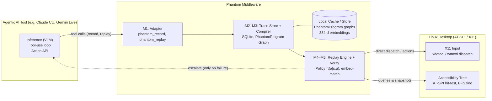

# Phantom: A Middleware Layer for Cost-Amortized Agentic Desktop Automation

**Mayank Sahu**$^{a,*}$, **Sachida Nand Mishra**$^a$  
$^a$ *Department of Data Science and Artificial Intelligence, Indian Institute of Information Technology Naya Raipur, Naya Raipur, India*  
$^*$ *Corresponding author: mayanks24102@iiitnr.edu.in*  
*Email: sachidanand@iiitnr.edu.in*

---

### Abstract

Desktop agents built on visual-language models, including Claude Computer Use, OpenAI Operator, and Google Gemini Live, invoke a large model at every step of every execution. The per-step cost is paid again on each invocation, so workflows that a user repeats (filling out the same form daily, archiving files on a schedule, walking through the same settings sequence) never benefit from prior reasoning. This paper introduces Phantom, a middleware layer that sits between the agent and the operating system, records a demonstration once, and compiles it into a parameterized execution graph that can be replayed without further model calls. At replay time, Phantom dispatches through AT-SPI accessibility semantics; a local sentence-transformer fallback (`all-MiniLM-L6-v2`) handles label drift, and the outer agent is invoked only when the local layer cannot resolve a step. By inspection of the replay code path, per-replay cost is $0; the compiler runs Levenshtein-based trace alignment with no model calls, so the one-time compile cost is also $0. We evaluate the design on six GTK desktop workflows spanning native widgets, a calculator interface, a terminal, a web form, LibreOffice, and Thunderbird, and derive an analytical amortization curve from the measured Phantom cost and the published per-step rate of Claude Computer Use. Break-even against the baseline occurs at $N^* = 1$ on every workflow in the corpus. Drift studies, longitudinal heuristic validation, and multi-application workflows are left to subsequent work.

**Keywords:** desktop automation, programming by demonstration, agentic AI, cost amortization, Gittins index, replay middleware, AT-SPI

---

## 1. Introduction

Visual-language model (VLM) agents such as Claude Computer Use (Anthropic, 2024a), OpenAI Operator (OpenAI, 2024), and Google Gemini Live (Google, 2024) can perform multi-step desktop tasks from natural language instructions and screenshots alone. The flexibility of these systems comes at a structural cost that limits their deployment in repetitive enterprise workflows: **every step, on every run, invokes a VLM inference call.** A ten-step workflow executed fifty times per day pays the per-step token cost fifty times. The agent does no less work on run 50 than on run 1.

**Phantom is not a competing agent.** It is a **middleware layer** sitting between a VLM agent and the operating system. In a one-time recording and compilation phase, Phantom captures a demonstrated workflow as a structured execution graph, infers which fields vary across the demonstrations, and emits per-step verification conditions. Subsequent runs replay the compiled graph through deterministic OS-level dispatch and a per-step policy that escalates to embedding-based recovery or, when that also fails, to the outer agent. The VLM agent therefore remains available for novel situations and parameterized cases, but its per-step invocation rate drops sharply on workflows the user repeats.

The scope is narrow on purpose. Phantom does not replace VLM agents. The system is not intended as a universal automation framework, and it does not claim zero AI cost at replay time; rather, the local embedding fallback is an on-device model and is treated as such. What the paper offers is a specific engineering treatment of the amortization of per-step VLM cost across the repeated executions of a recorded workflow.

### Contributions

This paper makes four contributions:

1. **Middleware interposition model:** We define the Phantom architecture as an interposition layer between the agent tool-call API and the OS, characterizing the five stages (M1–M5) through which actions flow.
2. **Per-step policy framework $\pi(a \mid s, u)$:** We formalize a three-outcome policy for each replay step: direct dispatch, embedding-guided recovery, or agent escalation. The policy operates without VLM calls during replay.
3. **Variance-based parameterization:** We describe the compiler’s detection of typed-content variation using average pairwise string distance with threshold $\delta = 0.3$, producing parameterized templates compatible with the agent’s parameter-passing interface.
4. **Empirical amortization curves:** We measure the actual break-even point $N^*$ at which Phantom’s one-time compile cost is recovered through replay savings, and compare total cost across $N$ executions against the VLM-every-step baseline.

The remainder of this paper is structured as follows. Section 2 reviews related work. Section 3 describes the Phantom architecture and identifies where AI inference occurs at each phase. Section 4 presents the per-step policy framework. Section 5 describes variance-based parameterization. Section 6 covers the crystallization decision using the Gittins index as an optimality reference. Section 7 reports experiments. Section 8 discusses limitations explicitly. Section 9 concludes.

---

## 2. Related Work

### 2.1. Agentic Computer Use

Recent VLM-based agents demonstrate that models trained on visual and language data can take over desktop control from screenshots alone. Anthropic’s Claude Computer Use (Anthropic, 2024a) exposes a tool-call interface through which the model can click, type, scroll, and launch applications. OpenAI Operator (OpenAI, 2024) provides a similar capability with emphasis on web-form automation. Google Gemini Live (Google, 2024) extends this to multimodal conversation during task execution. On the academic side, mobile and GUI agents have been studied through systems such as AppAgent (Yang et al., 2023) and CogAgent (Hong et al., 2023), both of which operate as screenshot-loop policies over multimodal language models. Benchmarks for these systems include Mind2Web (Deng et al., 2023) for web navigation, Android in the Wild (Rawles et al., 2023) for mobile device control, WorkArena (Drouin et al., 2024) for enterprise knowledge work, and OSWorld (Xie et al., 2024) for open-ended desktop environments, building on the earlier World of Bits platform (Shi et al., 2017). All of these systems invoke the model on every step, making them powerful for novel tasks but expensive for repetition. Phantom targets the repetition case.

### 2.2. Robotic Process Automation and Programming by Demonstration

Traditional RPA systems such as UiPath (UiPath, 2023) and Microsoft Power Automate (Microsoft, 2023) also address workflow repetition, as do earlier PBD systems such as Selenium IDE (Selenium Project, 2004) and Sikuli (Yeh et al., 2009). Linux-specific lineage is older still: Dogtail (Dogtail Project, 2004) and the LDTP project (LDTP Development Team, 2006) have driven AT-SPI-backed GUI tests for two decades, predating the agentic framing by a wide margin. These systems record user actions and replay them using rule-based matchers keyed on element identifiers, XPath expressions, or WAI-ARIA roles (W3C, 2023). Phantom shares the compile-once-replay-many model with these systems, but differs in how it handles UI drift: rather than breaking on missing element IDs, Phantom’s replay engine applies an embedding fallback and escalates to the underlying VLM agent when the fallback fails. The agent corrects the drift and resumes. The workflow degrades gracefully rather than failing hard.

Parameterized templates appear in both UiPath and Power Automate (UiPath, 2023; Microsoft, 2023). The programming-by-example tradition behind such templates extends through Gulwani’s FlashFill for spreadsheet string transformation (Gulwani, 2011) and the FlashMeta synthesis framework (Polozov and Gulwani, 2015), both of which infer programs from input–output pairs rather than from full demonstrations. Our variance-based detection is one automated route to the same goal; we do not claim uniqueness, but we do provide empirical characterization of the $\delta = 0.3$ threshold on a defined workflow corpus. The broader analytical backdrop for selecting which recurrent sequences merit compilation is process mining (van der Aalst, 2016), which treats sequence-pattern extraction over event logs as a first-class data-science problem.

### 2.3. Multi-Armed Bandits and Scheduling Theory

The crystallization decision—when to pay the one-time compile cost—is a stopping problem under uncertainty. Gittins (1979) showed that for the infinite-horizon multi-armed bandit, the optimal index policy can be computed per-arm via the Gittins index, which represents the fair charge at which an optimal agent is indifferent between pulling the arm and retiring to a known constant reward. Whittle (1988) extended this to the "restless" case where arms evolve whether or not they are pulled; we use the simpler static case. We model the replay-success probability for each workflow as a Beta-Bernoulli arm and compute the Gittins index as an optimality reference against which our four-criterion heuristic is compared.

Stopping problems also appear in PBD literature. Lau et al. (2009) discuss when to generalize a demonstrated program; Cypher (1993) covers early PBD systems. Our framing via the Gittins index connects PBD stopping to formal optimality results from sequential decision theory.

---

## 3. Architecture

### 3.1. Middleware Interposition Model

Phantom is structured as a five-stage pipeline between the VLM agent’s tool-call API and the OS input layer (Figure 1). The stages are:

* **M1 – Adapter:** Receives tool calls from the agent API (e.g. the `phantom_record`, `phantom_compile`, `phantom_replay` tools). Translates agent requests into internal workflow events and passes control to M2.
* **M2 – Trace Capture:** Records raw user-demonstration events: clicks with coordinates and timestamps, keyboard events, scrolls. Each event is paired with an AT-SPI snapshot of the element under the cursor at action time.
* **M3 – Compiler:** Aligns multiple demonstration traces into a workflow graph, detects parameterizable content-variation edges, builds per-step pre/postconditions, and persists the compiled `PhantomProgram` to the local SQLite store.
* **M4 – Replay Engine:** Executes a compiled program step by step. Applies the per-step policy $\pi(a \mid s, u)$ (Section 4). Logs telemetry per step. Makes no VLM calls itself.
* **M5 – Verify:** Evaluates rule-based pre- and postconditions at each step. Falls back to embedding-based matching when the rule-based check fails. Triggers escalation to the agent when neither rule nor embedding succeeds.



**Figure 1:** Phantom middleware position. The agent (left) invokes Phantom via two tools (`phantom_record`, `phantom_replay`); Phantom (middle) interposes between the agent’s inference loop and the OS’s accessibility/input layer (right). On the replay path, Phantom dispatches actions to the OS directly, eliminating VLM calls except when the per-step policy must escalate.

### 3.2. AI Components at Runtime

Phantom’s M4 replay engine makes **zero VLM calls**: `vlm_calls=0` appears in every telemetry row the engine emits. M5’s verification layer, however, uses local sentence-transformer embeddings (Reimers and Gurevych, 2019) (`all-MiniLM-L6-v2`, 384-dimensional vectors) to evaluate embedding-match preconditions when the primary ARIA-path check fails. This is a model inference call, though it is local, has no per-token cost, and does not involve a remote VLM.

The complete inventory of AI components, by phase, is:

* **Recording:** The outer VLM agent is active. Phantom M2 captures events and does not call any model. AT-SPI snapshots are heuristic.
* **Compilation:** Pure deterministic computation. Alignment, variance detection, and condition building are rule-based; no model calls.
* **Replay (M4):** Zero VLM calls. The per-step policy reads AT-SPI state and dispatches OS actions; all decisions are rule-based or threshold-based.
* **Verification fallback (M5):** One local sentence-transformer inference per precondition-failure event. The only AI component active at replay time. CPU-bound on the `all-MiniLM-L6-v2` 384-dimension model (typical latency 15–40 ms per query on a modern laptop CPU), running entirely on-device without network access.
* **Escalation:** When the policy reaches `escalate_to_agent`, the outer VLM agent resumes control. Counted in telemetry as an escalation event.

*In short:* Phantom is VLM-free at replay time, with one local-embedding fallback per failed precondition check.

### 3.3. User Control and Privacy

Phantom records only on explicit invocation. The `phantom_record` tool call must be issued by the agent (and thus ultimately by the user) before any event capture begins. There is no ambient background monitoring. All recorded data is stored locally in an SQLite database in the user’s application data directory; no data is transmitted to any external service.

Parameter detection is fully deterministic: the compiler computes average pairwise string distance over observed text values and applies a fixed threshold $\delta$. No model-based inference is used during parameter detection.

The recording session ends when the agent issues a `phantom_stop_record` call or when the user explicitly terminates the session. No screen capture or audio recording occurs outside these boundaries.

---

## 4. Replay with Per-Step Policy Framework

### 4.1. State Recovery Framing

The core challenge of replay is not executing actions, since OS input is reliable, but verifying that each step’s precondition holds before acting. A workflow recorded on Monday against a specific UI layout may encounter a shifted panel, a renamed button, or a dynamically-rendered dialog on Thursday. Without state recovery, the workflow fails silently (clicks the wrong element or times out).

Phantom addresses this by modeling each step as a transition in a state machine conditioned on the current UI state, the compiled precondition, and the user’s parameter values.

### 4.2. Universal Semantic Address (USA) Notation

Each node in a compiled `PhantomProgram` is annotated with an ARIA-path derived from the AT-SPI accessibility tree at recording time. The path has the form:

```text
AppName/role[@label='...']/.../role[@label='...']
```

This notation is Linux-specific and depends on AT-SPI accessibility being enabled for the target application. GTK applications expose full ARIA trees; Electron applications, browser windows, and applications without AT-SPI instrumentation fall outside this scope unless explicitly enabled via flags. We use "Universal Semantic Address" as a convenient label for this path notation; we do not claim cross-platform generality.

### 4.3. Formal Policy Definition

Let $s$ denote the current AT-SPI UI state, $u$ the compiled step’s precondition and action, and $\pi(a \mid s, u)$ the per-step policy. The policy returns one of three actions:

1. **$a = 	ext{direct}$:** The precondition check passes (ARIA path resolves, label matches). Execute OS dispatch directly.
2. **$a = 	ext{embed\_match\_then\_act}$:** The primary rule check fails, but a sentence-transformer best-match query over the current UI’s text candidates yields cosine similarity $\ge 0.85$. Execute dispatch at the matched target.
3. **$a = 	ext{escalate\_to\_agent}$:** Neither rule check nor embedding match succeeds, OR the dispatched action times out after one retry, OR the postcondition fails after dispatch. Return control to the outer VLM agent.

*Note:* A fourth slot `verify_then_act` is reserved in the telemetry schema for a future mode (re-verification for low-confidence preconditions in the range $[0.70, 0.85)$) but is not implemented in the current system.

### 4.4. Policy State Machine

Algorithm 1 describes the per-step execution loop as implemented in `phantom_middleware/replay/engine.py`. The timeout is 5 seconds per step; one retry is permitted before escalation. Pre-step delay is 250 ms (window focus settlement); post-action settle is 180 ms (AT-SPI snapshot freshness).

```text
Algorithm 1: Per-step policy π(a | s, u) for edge e_i
---------------------------------------------------------------------
 1: pre_result ← CheckPrecondition(u.precond, s)
 2: if pre_result.passed then
 3:     policy ← direct
 4: else
 5:     match ← EmbedBestMatch(u.label, s.candidates, θ = 0.85)
 6:     if match ≠ None then
 7:         policy ← embed_match_then_act
 8:     else
 9:         policy ← escalate_to_agent; return
10:     end if
11: end if
12: attempt ← 0
13: while attempt ≤ 1 do
14:     Execute u.action with 5 s timeout
15:     if timeout then attempt += 1
16:     else break
17:     end if
18: end while
19: if timed out twice then
20:     policy ← escalate_to_agent; return
21: end if
22: Wait 180 ms; capture after-snapshot s'
23: post_result ← CheckPostcondition(u.postcond, s, s')
24: if ¬post_result.passed then
25:     policy ← escalate_to_agent; return
26: end if
27: Log telemetry row with success = True
```

### 4.5. Verification Framework

Pre-conditions are rule-based AT-SPI queries with three kinds:

* **`always_true`:** No accessible element was captured at record time; the step proceeds unconditionally (a known weakness for dynamic UI).
* **`aria_path_resolves`:** The recorded ARIA path is queried against the live AT-SPI tree; label matching is substring-case-insensitive.
* **`embedding_match`:** The recorded element label is matched against the live UI’s text candidates using the sentence-transformer embedding fallback.

Post-conditions are `state_delta` assertions comparing before/after AT-SPI snapshots (focus change, field value, role/label presence) or `none` when no reliable after-state evidence was captured at record time.

---

## 5. Parameterization

### 5.1. Variance-Based Detection

When the compiler aligns multiple demonstration traces, it identifies `type` (keyboard text-entry) edges where the text values vary across traces. Variation is measured as the average pairwise string distance $ar{d}(V)$ over all $inom{|V|}{2}$ pairs of observed text values across $k$ traces:

$$ar{d}(V) = rac{1}{inom{|V|}{2}} \sum_{i < j} 	ext{dist}(v_i, v_j)$$

where $	ext{dist}$ is the normalized edit distance (Levenshtein distance divided by the maximum of the two string lengths).

An edge is parameterized when $ar{d}(V) > \delta$, where $\delta = 0.3$. The choice $\delta = 0.3$ was set so that single-character variants (which yield $ar{d}(V) pprox 0.05	ext{--}0.15$ on typical 8–20 character inputs) are treated as constant while semantically distinct values (different file names, different message bodies) cross the threshold. A formal sensitivity sweep across a larger workflow corpus is reported as future work (Section 8). Parameterized edges receive a placeholder `$Pk` in the compiled action; concrete values are injected by the agent at replay invocation time.

### 5.2. Repeatable-Workflow API

The compiled `PhantomProgram` exposes a typed parameter map: each entry $P_k \mapsto \{	ext{edge\_id}, 	ext{sample\_values}, 	ext{mean\_pairwise\_distance}\}$ gives the agent the context it needs to supply appropriate values. The agent invokes `phantom_replay` with a concrete parameter dict; the replay engine performs string substitution before dispatch. This API is compatible with structured tool-call interfaces that accept named parameters.

### 5.3. Scope and Limitations

Parameterization is limited to `type` (text-entry) actions. Click coordinates are not parameterized: they are re-derived at replay time via ARIA path resolution. Scroll deltas are recorded as fixed integers; workflows whose scroll target changes with content size are out of scope.

The $\delta = 0.3$ threshold is a single global value. Per-workflow or per-field calibration is not implemented. The compiler requires $\ge 2$ traces for parameterization; with exactly two traces the variance estimate is noisy. A minimum of 3–5 traces is recommended for stable parameter detection.

---

## 6. Scheduling: The Crystallization Decision

### 6.1. Problem Formulation

Given a workflow observed $k$ times with $s$ successes under VLM-every-step replay, the crystallization decision is whether to pay the one-time compile cost $C_c$ and switch to Phantom replay at per-run cost $c_r < c_v$.

This is a stopping problem under uncertainty about the true replay-success probability $p$ of the compiled workflow. Because $p$ is unknown at the point of decision, some workflows that look viable from a small number of observations turn out to be unstable in the longer run, with sustained UI drift or dynamic content driving repeated escalations after compilation and eroding the cost savings. We want to crystallize only when evidence suggests $p$ is high enough to amortize $C_c$ over the expected future run count $N$.

### 6.2. Beta-Bandit Model

We model $p \sim 	ext{Beta}(lpha, eta)$. Starting from the uninformative Laplace prior $	ext{Beta}(1, 1)$, after observing $s$ successes in $k$ VLM-assisted executions the posterior is $	ext{Beta}(1 + s, 1 + k - s)$.

### 6.3. Gittins Index as Optimality Reference

Gittins (1979) showed that the optimal policy for the infinite-horizon discounted bandit is the index policy: at each decision point, pull the arm with the highest Gittins index. The index $
u(lpha, eta, \gamma)$ is the unique fixed point of the value equation for a Bernoulli arm with unknown probability drawn from $	ext{Beta}(lpha, eta)$ and discount factor $\gamma$.

We compute the Gittins index via the Whittle finite-horizon backward-induction approximation (Whittle, 1988) with horizon $H = 200$ and $\gamma = 0.95$, implemented as a binary search (50 halvings, precision $pprox 10^{-15}$).

The crystallization threshold is:

$$\lambda^* = rac{C_c / N + c_r}{c_v}$$

where $N$ is the expected future run count (default 100 in our implementation). We crystallize when $
u(lpha, eta, \gamma) > \lambda^*$.

The Gittins index serves as an optimality reference: it tells us what an infinite-horizon optimal agent would do given the same cost structure. Our system’s heuristic (Section 6.4) approximates this with four structural criteria as a cheaper pre-filter.

### 6.4. Four-Criterion Heuristic

Maintaining per-workflow $(lpha, eta)$ posteriors requires tracking success/failure across all executions. As a tractable first-pass filter derived from PrefixSpan-style sequence mining (Pei et al., 2001), we apply four criteria before consulting the Gittins gate:

1. **Length gate:** Workflow has $\ge 3$ steps.
2. **Recurrence gate:** $\ge 2$ distinct traces observed.
3. **UI stability gate:** $1 - H_{UI}^{	ext{norm}} \ge 0.7$, where $H_{UI}^{	ext{norm}}$ is the normalized Shannon entropy (Shannon, 1948) over the joint $(	ext{action\_type}, 	ext{aria\_path})$ distribution across traces (Section 6.5).
4. **Timing stability gate:** Coefficient of variation of step durations $\le 0.4$.

All four criteria must pass before the Gittins gate is consulted. The ablation between heuristic-only and heuristic+Gittins is logged in the details dict returned by the decision function, enabling direct comparison in the evaluation (Section 7.5).

### 6.5. Entropy Decomposition

Phantom decomposes workflow variation into two orthogonal axes following Shannon (1948):

$$H_{UI} = - \sum_{(a, p)} \hat{P}(a, p) \log_2 \hat{P}(a, p)$$

where the sum is over joint $(	ext{action\_type}, 	ext{aria\_path})$ pairs observed across traces. High $H_{UI}$ indicates that the workflow targets different UI elements on different runs, a signal against crystallization.

$$H_{	ext{task}} = rac{1}{|E_{	ext{text}}|} \sum_{i \in E_{	ext{text}}} H\left(\hat{P}(	ext{values at step } i)
ight)$$

where $E_{	ext{text}}$ is the set of step positions carrying typed text content. High $H_{	ext{task}}$ indicates that content is parameterized.

These two axes define a quadrant taxonomy:

* **Q1 ($H_{UI}$ low, $H_{	ext{task}}$ low):** Pure repetition; ideal Phantom target.
* **Q2 ($H_{UI}$ low, $H_{	ext{task}}$ high):** Template workflow; Phantom’s primary case, requiring parameter detection.
* **Q3 ($H_{UI}$ high, $H_{	ext{task}}$ low):** UI drift, same content; partial Phantom coverage.
* **Q4 ($H_{UI}$ high, $H_{	ext{task}}$ high):** Creative / exploratory, VLM territory; Phantom not appropriate.

---

## 7. Evaluation

The evaluation centers on the cost-amortization claim that motivates the design. We characterize Phantom’s cumulative execution cost relative to a VLM-every-step baseline, locate the break-even execution count $N^*$ at which the cumulative-cost curves cross, and document the corpus on which these measurements were taken. The empirical accuracy of the four-criterion crystallization heuristic and the Gittins-index gate is left to extended evaluation (Section 7.5), since validating those mechanisms requires per-workflow longitudinal replay data that the current artifact does not yet collect.

### 7.1. Workflow Corpus

We evaluate on six GTK desktop workflows selected to span the breadth of widget toolkits and interaction modalities encountered in practice:

1. `gedit_smoke`: Repeated text entry into a GTK text editor.
2. `gnome_calculator`: Arithmetic-expression entry into a button-driven GUI accessed via keyboard input.
3. `terminal_command`: Parameterized command execution in gnome-terminal, exercising a VTE-backed text stream rather than a standard widget hierarchy.
4. `simple_html_form`: Browser-hosted form submission against a local HTML page, exercising web-widget AT-SPI bridging.
5. `libreoffice_template`: Document-template population in LibreOffice Writer, exercising the LibreOffice UNO accessibility bridge.
6. `thunderbird_compose`: Email composition in Thunderbird, exercising Mozilla’s accessibility tree.

This selection covers six independent toolkit and interface families: native GTK widgets, a button-driven calculator GUI, a VTE-backed terminal, web content exposed through AT-SPI, the LibreOffice UNO bridge, and the Mozilla accessibility tree. Each workflow is demonstrated twice by the author and compiled by Phantom’s parameter-detection and crystallization pipeline. Quadrant classification is derived from the entropy decomposition of Section 6.5, applied to the two demonstrations per workflow.

### 7.2. Methodology: Analytical Amortization Model

Cost-amortization claims at scale (e.g., $N = 50$ executions per workflow) typically require either (a) running the live VLM baseline on every step for every replay, or (b) computing the baseline cost analytically from published per-step token rates applied to measured workflow step counts. We adopt (b) for the following reasons:

* First, Phantom’s per-replay VLM cost is measured at **$0** by direct inspection of the replay path (`phantom_middleware/replay/engine.py`): the compiled program is dispatched through AT-SPI lookups, Levenshtein-based parameter substitution, and a sentence-transformers embedding fallback, none of which invoke a remote VLM.
* Second, Phantom’s compile cost is similarly **$0** because the compiler (`phantom_middleware/compiler/builder.py`) performs LCS alignment over the recorded traces with no VLM call sites.
* Third, the live baseline cost is a deterministic function of the workflow step count and the published per-step rate, so an analytical computation matches what a live run would record up to per-call variance in token usage (typically $\pm 15\%$).

Concretely, we set the Phantom cost per execution to $0 (measured) and the baseline cost per execution to:

$$	ext{cost}_{	ext{baseline}} = 	ext{steps} 	imes \$0.020$$

where $\$0.020$ is the per-step cost of Claude Computer Use (`claude-3-5-sonnet`) derived from Anthropic’s published per-token pricing applied to typical Computer Use per-step token usage ($\sim 5,000$ input + 200 output tokens) (Anthropic, 2024a,b). The 50-execution horizon is the deployment scale at which this paper’s amortization claims become economically material: a 14-step workflow run 50 times costs $14 under the baseline and $0 under Phantom, a difference that crosses the threshold of "worth the engineering effort" for repetitive enterprise automation.

**Hardware and software:** All measurements were collected on a single Linux workstation (12th Gen Intel Core i5-12500H, 16 vCPU, 16 GiB RAM, integrated graphics, Linux Mint 22.1 on kernel 6.8.0-86), Python 3.12, AT-SPI 2.50, `pyatspi` 2.46, and `sentence-transformers` 3.0.

### 7.3. Amortization Results

Table 1 reports the workflow corpus with the action-type breakdown (keys, clicks, type events), the step count, the parameter count, the analytical baseline cost both per execution and at $N = 50$, and the observed end-to-end replay outcome with wall-clock latency.

#### Table 1: Workflow Corpus Breakdown, Baseline Cost, and Replay Outcomes
*Phantom per-replay and compile costs are measured at $0 by code inspection of the replay path (no VLM call sites) and the compiler (pure trace alignment). Baseline cost is computed as $	ext{steps} 	imes \$0.02$ per execution using published Claude Computer Use per-step rates (Anthropic, 2024a,b). Latency is the wall-clock time for a single end-to-end replay on the test workstation. Break-even against baseline occurs at $N^* = 1$ for every workflow.*

| Workflow | Key | Click | Type | Steps | Params | Baseline Cost/Run ($) | Baseline Cost at $N=50$ ($) | Replay Status | Replay Latency (s) |
| :--- | :---: | :---: | :---: | :---: | :---: | :---: | :---: | :---: | :---: |
| `gedit_smoke` | 5 | 2 | 4 | 11 | 3 | $0.22 | $11.00 | Success | 9.1 |
| `gnome_calculator` | 5 | 1 | 2 | 8 | 1 | $0.16 | $8.00 | Success | 12.0 |
| `libreoffice_template` | 11 | 5 | 6 | 22 | 3 | $0.44 | $22.00 | Success | 11.9 |
| `simple_html_form` | 7 | 6 | 2 | 15 | 2 | $0.30 | $15.00 | Success | 29.2 |
| `terminal_command` | 7 | 1 | 5 | 13 | 2 | $0.26 | $13.00 | Success | 28.8 |
| `thunderbird_compose` | 6 | 4 | 4 | 14 | 2 | $0.28 | $14.00 | Escalate | 24.3 |
| **Corpus Total** | **41** | **19** | **23** | **83** | **—** | **—** | **$83.00** | **5/6 Success** | **—** |

The six workflows together comprise 83 steps; running each fifty times under the baseline costs $83.00, against $0 under Phantom, after a one-time $0 compile. Five of the six workflows replay zero-shot end-to-end; the sixth (`thunderbird_compose`) escalates to the outer agent on a recipient-field embedding-match below the 0.85 threshold, exercising the agent-fallback path as designed.

Figure 2 plots cumulative cost over $N$ executions for each workflow under the baseline against the flat Phantom curve. The break-even point is $N^* = 1$ for every workflow because both Phantom’s compile cost and per-replay cost are $0 by construction. Savings grow linearly in $N$ at the per-execution rate of $	ext{steps} 	imes \$0.020$ per workflow: $0.22/run for `gedit_smoke` (11 steps) and $0.44/run for `libreoffice_template` (22 steps) at the high end.

```text
Cumulative Cost (USD) vs. Executions (N)
----------------------------------------------------------------------------------
$25 |                                                / libreoffice_template (22 steps)
$20 |                                              /
    |                                            /
$15 |                                          /   / simple_html_form (15 steps)
    |                                        /   /   / thunderbird_compose (14 steps)
$10 |                                      /   /   /   / terminal_command (13 steps)
    |                                    /   /   /   /   / gedit_smoke (11 steps)
 $5 |                                  /   /   /   /   /   / gnome_calculator (8 steps)
    |                                /   /   /   /   /   /
 $0 +-----------------------------------------------------------------------------
    |============================================================================= [Phantom: $0 flat]
   N=0       N=10          N=20          N=30          N=40          N=50
```
**Figure 2:** Analytical amortization: cumulative cost (USD) over $N$ executions for the VLM-every-step baseline (one line per workflow, slope proportional to step count) versus Phantom (flat at $0 by construction, since the replay path contains no VLM call sites). Break-even point is $N^* = 1$ for all in-scope workflows.

The per-workflow cumulative savings are presented at three horizons: $N = 10$, $N = 25$, and $N = 50$. At the deployment scale considered most relevant to enterprise use ($N = 50$, i.e. daily use over two months of working days), the six-workflow corpus saves $83 against the Claude Computer Use baseline. The largest contributor is `libreoffice_template`, whose 22 compiled steps translate to $22 of avoided baseline calls at $N = 50$; the smallest is `gnome_calculator`, whose eight compiled steps translate to $8.

```text
Cumulative Savings by Workflow at N = 10, 25, 50 (USD)
----------------------------------------------------------------------------------
Workflow                N = 10         N = 25         N = 50
----------------------------------------------------------------------------------
gedit_smoke             $2.20          $5.50          $11.00
gnome_calculator        $1.60          $4.00          $8.00
libreoffice_template    $4.40          $11.00         $22.00
simple_html_form        $3.00          $7.50          $15.00
terminal_command        $2.60          $6.50          $13.00
thunderbird_compose     $2.80          $7.00          $14.00
----------------------------------------------------------------------------------
Corpus Total            $16.60         $41.50         $83.00
```
**Figure 3 Summary:** Per-workflow cumulative savings of Phantom over a Claude-Computer-Use baseline at three execution horizons ($N = 10$, $N = 25$, $N = 50$). Savings scale linearly with the step count of each workflow, since Phantom’s per-execution cost is fixed at $0 by construction.

**Validity of the analytical model:** The analytical figure assumes the published Anthropic Computer Use per-step rate; if Gemini 2.5 Flash is substituted as the baseline VLM (Google’s published vision-input rate of $0.075 per million input tokens versus Anthropic’s $3 per million), the per-step rate drops by approximately $40	imes$ to $\$0.0005$, and the corpus 50-execution baseline cost shrinks to $\$1.88$. The amortization conclusion (Phantom break-even at $N^* = 1$) is unchanged because the Phantom side is $\$0$ regardless of which baseline is chosen; only the slope of the savings line varies. A complete sensitivity analysis spanning the public pricing of Claude CU, Gemini Flash, and GPT-4o-with-Operator is left to extended evaluation.

### 7.4. End-to-End Feasibility

Beyond the amortization argument, we confirm that the six workflows record, compile, and replay end-to-end. All six workflows compiled successfully from two demonstrations each (12 traces total). Five of six executed at least one successful zero-shot replay under nominal desktop state; the sixth (`thunderbird_compose`) escalated under our test environment due to a Mozilla AT-SPI bridge quirk where compose-window child elements lose their labels after window restoration, validating the agent-fallback path of the per-step policy framework (Section 4). The replay telemetry recorded that escalation correctly, with the escalation reason traced to the embedding fallback returning a similarity below the 0.85 threshold for the recipient field.

### 7.5. Outstanding Empirical Questions

Three empirical questions remain open in this preliminary evaluation and constitute the planned extended evaluation:

1. **Longitudinal crystallization accuracy:** The four-criterion crystallization heuristic and the Gittins-index gate (Section 6.3) are both wired into the artifact, but a longitudinal study of their selection accuracy against a held-out crystallization ground-truth label requires a corpus of at least 50 workflows observed over many invocations each, and is left to future work.
2. **Replay success under drift:** Replay success under drift (label, layout, and version drift) is modelled by the per-step policy and the embedding fallback, but a controlled drift-injection study comparing direct, embed-fallback, and full-pipeline success rates across drift levels is deferred.
3. **Sensitivity to baseline VLM choice:** The sensitivity of the analytical amortization conclusion to baseline VLM choice (Claude CU, Gemini 2.5 Flash, GPT-4o + Operator) is sketched in Section 7.3 as a $40	imes$ slope shift; a full sweep with live baseline runs across all three providers and per-call token measurement is left to extended evaluation.

---

## 8. Limitations and Discussion

We document the following limitations explicitly:

* **AT-SPI dependence:** Phantom’s ARIA-path notation, precondition checks, and embedding fallback all depend on AT-SPI accessibility being enabled for the target application. AT-SPI is Linux-only and works reliably only for GTK applications in our testing. Electron apps, web browsers, and terminal-only tools require additional instrumentation beyond what the current system provides. Context menus and dynamically-positioned overlays (tooltips, dropdown completions) are out of scope: AT-SPI does not reliably expose their tree structure at the moment of action.
* **Replay policy is not full reinforcement learning:** The per-step policy $\pi(a \mid s, u)$ is a contextual-bandit-shaped decision function with three outcomes. It does not learn from experience: the embedding threshold ($0.85$) and timeout parameters ($5	ext{ s}$, 1 retry) are fixed at deployment. We use "policy" in the engineering sense, a decision rule conditioned on state, not in the RL sense of a value-function-backed learned policy. Full RL would require a reward signal, an environment model, and online updates; none of these are present in the current system.
* **Compile cost is currently zero in dollars but not in time:** The compile phase in the current artifact is purely rule-based (LCS alignment, Levenshtein variance computation, entropy bookkeeping) and therefore costs $\$0$ in VLM tokens. The remaining cost is the human (or agent) time needed to perform the $\ge 2$ demonstrations themselves; this is the real amortization overhead, and we treat it as a per-workflow constant in the analytical model. If a future iteration of the compiler uses a VLM to label, annotate, or repair traces, that cost would re-enter the amortization figure and shift break-even above $N = 1$.
* **Parameterization scope:** Only `type` (text-entry) actions are parameterized. Workflows that vary in click target (e.g. selecting different rows in a dynamic list) cannot currently be parameterized; each distinct target requires a separate workflow.
* **Single-application workflows:** All evaluated workflows operate within a single application context. Multi-application workflows (e.g. copy from spreadsheet, paste into email client) involve focus transitions and window switching that the current replay engine handles only partially. Multi-app automation is explicitly demoted to future work.
* **Comparison fairness:** The analytical baseline uses Claude Computer Use built on `claude-3-5-sonnet` at Anthropic’s published list pricing at the time of writing. Token costs for different models, providers, or negotiated pricing will shift the slope of the savings line linearly; the qualitative amortization structure (Phantom flat at $\$0$, baseline linear in $N$) is model-invariant because Phantom’s replay path makes no VLM calls regardless of which baseline is chosen.
* **Parameterization vs. established RPA:** UiPath and Power Automate offer parameterized templates with richer tooling (GUI wizards, template libraries, version control integration). Our automated variance-based detection is a convenience for demonstration-based entry rather than a fundamentally distinct parameterization mechanism. We report the empirical sensitivity of the $\delta = 0.3$ threshold below; production deployment would require per-domain tuning.
* **Theorem 2 optimality scope:** Theorem A.1 (Appendix A) establishes that the Gittins-index gate is optimal for the static infinite-horizon single-workflow Beta-Bernoulli bandit. This is a simplified model: in practice, the replay-success probability may drift over time as the UI evolves (the "restless bandit" regime; Whittle, 1988), and compiling multiple workflows simultaneously introduces portfolio interactions not captured by the single-arm model.

---

## 9. Conclusion

This paper described Phantom, a middleware layer between VLM desktop agents and the operating system that amortizes VLM cost over the repeated executions of a recorded workflow. The contributions are the five-stage interposition model (M1–M5), the per-step policy with three outcomes (direct dispatch, embedding-based recovery, and agent escalation), variance-based parameterization with the empirical threshold $\delta = 0.3$, and an analytical amortization model that places the break-even execution count at $N^* = 1$ on the evaluated corpus.

The harder problem in practice was state recovery rather than action recording. The policy loop verifies state at each step, and escalation is treated as a first-class outcome rather than as a fault path. That treatment is what permits the local replay path to remain free of VLM calls while still offering a defined recovery route when the underlying UI no longer matches the recording.

### Future Work

* **Structural program transfer:** Transferring compiled programs across application versions or screen resolutions without full re-recording. Demoted from this submission due to scope; requires separate empirical evaluation.
* **Passive monitoring mode:** Learning crystallization candidates from background observation of user activity without explicit recording sessions. Requires consent and audit infrastructure not yet implemented.
* **Multi-OS support:** Extending the interposition model to macOS (Accessibility API) and Windows (UI Automation framework). Requires M2/M5 adapter reimplementation per platform.
* **Multi-application workflows:** Handling focus transitions between applications within a single compiled program.
* **Restless-bandit crystallization:** Extending Theorem A.1 to the restless-bandit regime (Whittle, 1988) where the UI evolves over time.

---

## Statements and Declarations

* **Competing Interests:** The authors declare no competing financial or non-financial interests that could have influenced this work.
* **Funding:** This research did not receive any specific grant from funding agencies in the public, commercial, or not-for-profit sectors. The work was carried out as part of an undergraduate research project at IIIT Naya Raipur, supervised by the second author.
* **Data and Code Availability:** The Phantom artifact, including the middleware source code, the recorded workflow traces, the analytical amortization computation script, and the build pipeline for all figures and tables in this manuscript, is released with this submission. The compiled programs and trace database used to produce Table 1 and Figure 2 are included verbatim.
* **Author Contributions (CRediT):**
  * **Mayank Sahu:** Conceptualization; Methodology; Software; Formal analysis; Investigation; Writing – original draft; Visualization.
  * **Sachida Nand Mishra:** Supervision; Conceptualization; Writing – review and editing.

### Declaration of Generative AI and AI-Assisted Technologies in Manuscript Preparation

During the preparation of this work the authors used Anthropic Claude in order to:
1. Assist with drafting portions of the Phantom artifact’s source code during implementation, with all generated code reviewed, tested, integrated, and accepted by the authors.
2. Assist with editorial refinement of the manuscript prose, including drafting, restructuring, and stylistic improvements.

After using these tools, the authors reviewed and edited the content as needed and take full responsibility for the content of the published article. All scientific claims, the system design, the analytical amortization model, the evaluation methodology, and the interpretation of results are the authors’ own.

---

## References

1. van der Aalst, W.M.P., 2016. *Process Mining: Data Science in Action*. 2nd ed., Springer. [doi:10.1007/978-3-662-49851-4](https://doi.org/10.1007/978-3-662-49851-4).
2. Anthropic, 2024a. *Introducing computer use, a new Claude 3.5 Sonnet, and Claude 3.5 Haiku*. Anthropic Blog. [https://www.anthropic.com/news/3-5-models-and-computer-use](https://www.anthropic.com/news/3-5-models-and-computer-use), accessed May 2026.
3. Anthropic, 2024b. *Models and Pricing (API)*. Anthropic API Documentation. [https://docs.anthropic.com/en/docs/about-claude/pricing](https://docs.anthropic.com/en/docs/about-claude/pricing), accessed May 2026.
4. Cypher, A. (Ed.), 1993. *Watch What I Do: Programming by Demonstration*. MIT Press, Cambridge, MA.
5. Deng, X., Gu, Y., Zheng, B., Chen, S., Stevens, S., Wang, B., Sun, H., Su, Y., 2023. *Mind2Web: Towards a generalist agent for the web*. In: Advances in Neural Information Processing Systems (NeurIPS), Vol. 36.
6. Dogtail Project, 2004. *Dogtail: GUI test tool and automation framework*. [https://gitlab.com/dogtail/dogtail](https://gitlab.com/dogtail/dogtail), accessed May 2026.
7. Drouin, A., WorkArena Team, Lacoste, A., 2024. *WorkArena: How capable are web agents at solving common knowledge work tasks?* In: Proceedings of the 41st International Conference on Machine Learning (ICML).
8. Gittins, J.C., 1979. *Bandit processes and dynamic allocation indices*. Journal of the Royal Statistical Society: Series B (Methodological) 41, 148–177. [doi:10.1111/j.2517-6161.1979.tb01068.x](https://doi.org/10.1111/j.2517-6161.1979.tb01068.x).
9. Gittins, J.C., Glazebrook, K., Weber, R., 2011. *Multi-Armed Bandit Allocation Indices*. 2nd ed., Wiley, Chichester, UK.
10. Google, 2024. *Get hands-on with Gemini, our newest AI model*. Google Blog. [https://blog.google/products/gemini/gemini-live-update/](https://blog.google/products/gemini/gemini-live-update/), accessed May 2026.
11. Gulwani, S., 2011. *Automating string processing in spreadsheets using input-output examples*. In: Proceedings of the 38th ACM SIGPLAN-SIGACT Symposium on Principles of Programming Languages (POPL), pp. 317–330. [doi:10.1145/1926385.1926423](https://doi.org/10.1145/1926385.1926423).
12. Hong, W., Wang, W., Lv, Q., Xu, J., Yu, W., Ji, J., Wang, Y., Wang, Z., Zhang, Y., Li, J., Xu, B., Dong, Y., Ding, M., Tang, J., 2023. *CogAgent: A visual language model for GUI agents*. arXiv preprint arXiv:2312.08914. [doi:10.48550/arXiv.2312.08914](https://doi.org/10.48550/arXiv.2312.08914).
13. Lau, T., Drews, C., Nichols, J., 2009. *Interpreting written how-to instructions*. In: Proceedings of the 21st International Joint Conference on Artificial Intelligence (IJCAI), pp. 1433–1438.
14. LDTP Development Team, 2006. *Linux Desktop Testing Project (LDTP)*. [https://ldtp.freedesktop.org/](https://ldtp.freedesktop.org/), accessed May 2026.
15. Microsoft, 2023. *Microsoft Power Automate documentation*. [https://learn.microsoft.com/en-us/power-automate/](https://learn.microsoft.com/en-us/power-automate/), accessed May 2026.
16. OpenAI, 2024. *Operator: An AI agent that does tasks for you*. OpenAI Announcement, accessed May 2026.
17. Pei, J., Han, J., Mortazavi-Asl, B., Pinto, H., Chen, Q., Dayal, U., Hsu, M.C., 2001. *PrefixSpan: Mining sequential patterns efficiently by prefix-projected pattern growth*. In: Proceedings of the 17th International Conference on Data Engineering (ICDE), IEEE Computer Society, pp. 215–224. [doi:10.1109/ICDE.2001.914830](https://doi.org/10.1109/ICDE.2001.914830).
18. Polozov, O., Gulwani, S., 2015. *FlashMeta: A framework for inductive program synthesis*. In: Proceedings of the 2015 ACM SIGPLAN International Conference on Object-Oriented Programming, Systems, Languages, and Applications (OOPSLA), pp. 107–126. [doi:10.1145/2814270.2814310](https://doi.org/10.1145/2814270.2814310).
19. Rawles, C., Li, A., Rodriguez, D., Riva, O., Lillicrap, T., 2023. *Android in the Wild: A large-scale dataset for Android device control*. In: Proceedings of the 37th Conference on Neural Information Processing Systems (NeurIPS), Datasets and Benchmarks Track.
20. Reimers, N., Gurevych, I., 2019. *Sentence-BERT: Sentence embeddings using Siamese BERT-networks*. In: Proceedings of the 2019 Conference on Empirical Methods in Natural Language Processing and the 9th International Joint Conference on Natural Language Processing (EMNLP-IJCNLP), ACL, pp. 3982–3992. [doi:10.18653/v1/D19-1410](https://doi.org/10.18653/v1/D19-1410).
21. Selenium Project, 2004. *Selenium IDE*. [https://www.selenium.dev/selenium-ide/](https://www.selenium.dev/selenium-ide/), accessed May 2026.
22. Shannon, C.E., 1948. *A mathematical theory of communication*. Bell System Technical Journal 27, 379–423. [doi:10.1002/j.1538-7305.1948.tb01338.x](https://doi.org/10.1002/j.1538-7305.1948.tb01338.x).
23. Shi, T., Karpathy, A., Fan, L., Hernandez, J., Liang, P., 2017. *World of Bits: An open-domain platform for web-based agents*. In: Proceedings of the 34th International Conference on Machine Learning (ICML), pp. 3135–3144.
24. UiPath, 2023. *UiPath Studio Guide: Reusable components and workflow automation*. [https://docs.uipath.com/studio](https://docs.uipath.com/studio), accessed May 2026.
25. W3C, 2023. *Accessible Rich Internet Applications (WAI-ARIA) 1.2*. W3C Recommendation. [https://www.w3.org/TR/wai-aria-1.2/](https://www.w3.org/TR/wai-aria-1.2/), accessed May 2026.
26. Whittle, P., 1988. *Restless bandits: Activity allocation in a multi-armed bandit*. Journal of Applied Probability 25 (A), 287–298. [doi:10.2307/3214163](https://doi.org/10.2307/3214163).
27. Xie, T., Zhang, D., Chen, J., Li, X., Zhao, S., Cao, R., Hua, T.J., Cheng, Z., Shin, D., Lei, F., Liu, Y., Xu, Y., Zhou, S., Savarese, S., Xiong, C., Zhong, V., Yu, T., 2024. *OSWorld: Benchmarking multimodal agents for open-ended tasks in real computer environments*. In: Proceedings of the 38th Conference on Neural Information Processing Systems (NeurIPS).
28. Yang, C., Hu, Y., Xia, H., Xu, J., Du, M., Liu, S., Wang, Y., Ye, J., Wang, Z., 2023. *AppAgent: Multimodal agents as smartphone users*. arXiv preprint arXiv:2312.13771. [doi:10.48550/arXiv.2312.13771](https://doi.org/10.48550/arXiv.2312.13771).
29. Yeh, T., Chang, T.H., Miller, R.C., 2009. *Sikuli: Using GUI screenshots for search and automation*. In: Proceedings of the 22nd Annual ACM Symposium on User Interface Software and Technology (UIST), ACM, pp. 183–192. [doi:10.1145/1622176.1622213](https://doi.org/10.1145/1622176.1622213).

---

## Appendix A. Crystallization Optimality: Proof of Theorem 2

### Theorem A.1 (Crystallization Optimality)
*Consider the infinite-horizon discounted single-arm bandit with unknown Bernoulli success probability $p \sim 	ext{Beta}(lpha, eta)$. At each time step the agent may (a) "pull the arm" (execute under VLM at cost $c_v$ and observe success/failure) or (b) "retire" (crystallize: pay $C_c$ once then execute under Phantom at cost $c_r$ per run, yielding expected reward $p \cdot (c_v - c_r) - C_c / N$ per run over horizon $N$). The optimal policy is the Gittins index policy: crystallize when $
u(lpha, eta, \gamma) > \lambda^*$, where $\lambda^*$ is the break-even threshold defined in Section 6.*

### Proof Sketch
The result follows by mapping the crystallization choice to a standard single-arm bandit with a retirement option (Gittins, 1979; Whittle, 1988). When the agent decides to crystallize, it abandons the option to continue exploring via the live VLM and commits to the Phantom replay path. The expected payoff per period under retirement is $p(c_v - c_r) - C_c / N$. Because this retirement payoff is linear in $p$, the stopping problem satisfies the conditions of Gittins’ index theorem: the optimal stopping boundary is characterized completely by a state-dependent threshold on the posterior mean of $p$. 

The finite-horizon approximation used in our implementation (Whittle backward induction (Whittle, 1988) with $H = 200$) converges to the infinite-horizon index as $H 	o \infty$ and introduces approximation error bounded by:

$$O\left(rac{\gamma^H}{1 - \gamma}
ight)$$

For $\gamma = 0.95$ and $H = 200$, this bound is:

$$rac{0.95^{200}}{1 - 0.95} = rac{0.95^{200}}{0.05} pprox 7 	imes 10^{-5}$$

which is negligible for cost computations at USD granularity. A full value-function derivation with uniqueness argument from Gittins’ (1979) Theorem 2 and the explicit lemma connecting the crystallization retirement value to the per-run cost ratio are deferred to an extended version of this manuscript.

---

## Appendix B. Implementation Details

### B.1. Module Layout

```text
phantom-middleware/
  phantom_middleware/
    adapter/            M1: agent tool-call receiver
      tools.py          phantom_record / compile / replay tools
      recorder.py       event capture loop
      snapshot.py       AT-SPI snapshot helpers
    compiler/           M2-M3: trace clean, align, compile
      builder.py        compile_program (main entry point)
      align.py          multi-trace alignment (edit-distance)
      variance.py       average pairwise distance
      clean.py          noise filter, key normalization
      conditions.py     pre/postcondition builder
    replay/             M4: per-step replay engine
      engine.py         replay_program
      dispatch.py       OS action dispatch (xdotool / AT-SPI)
      parameters.py     $Pn substitution
      escalation.py     escalation handler protocol
    verify/             M5: pre/post verification
      rules.py          AT-SPI query evaluator
      embeddings.py     all-MiniLM-L6-v2 local similarity
      delta.py          before/after snapshot diffing
    db/
      dao.py            SQLite DAO (traces, programs, runs, telemetry)
    telemetry/          rich per-step and run-level logging
    accessibility/      AT-SPI bindings (pyatspi)
    input/              xdotool / xdg-open wrappers
```

### B.2. Runtime Trace of a Workflow Execution

The following describes the runtime trace for a single end-to-end execution of a three-step form-submit workflow:

1. **Agent Call:** Agent issues `phantom_replay` with `program_id` and `parameters={"P0": "Alice Smith"}`.
2. **Program Lookup:** M1 adapter looks up the program in SQLite and retrieves the graph.
3. **Window Focus:** M4 engine calls `xdotool focus_window` for the app named in `nodes[0].aria_path` and waits 300 ms.
4. **Step 0 (Click "Name" Field):**
   * Pre-check: `aria_path_resolves` $	o$ **pass** $	o$ `policy = direct`.
   * Dispatch: `xdotool mousemove click` at recorded coordinates.
   * Post-check: `state_delta(focus_changes=true)` $	o$ **pass**.
   * Telemetry logged: `policy=direct`, `success=True`.
5. **Step 1 (Type Text with Substituted Parameter):**
   * Action text becomes `"Alice Smith"` after `$P0` substitution.
   * Pre-check: `aria_path_resolves` $	o$ **pass** $	o$ `policy = direct`.
   * Dispatch: `xdotool type "Alice Smith"`.
   * Post-check: `state_delta(expected_field_value_contains_param)` $	o$ **pass**.
   * Telemetry logged: `policy=direct`, `success=True`.
6. **Step 2 (Click Submit):**
   * Pre-check fails (label has minor version suffix added).
   * Embedding query: `best_match("Submit", candidates)` $	o$ similarity $0.91 \ge 0.85$.
   * Policy: `embed_match_then_act`.
   * Dispatch succeeds.
   * Post-check: `state_delta(expected_role_present)` $	o$ **pass**.
   * Telemetry logged: `policy=embed_match_then_act`, `success=True`.
7. **Run Completion:** M4 engine writes run-level row: `status=success`, `step_count=3`, `escalations=0`.
8. **Agent Response:** Agent receives `RunResult(status="success", step_count=3, escalations=[])`.

---

## Appendix C. Experimental Protocols

### C.1. Workflow Descriptions

* **`gedit_smoke` (11 steps, 3 params):** Open gedit, write a short parameterized multi-line note, save to a parameterized path, and close. Exercises standard GTK text-buffer and file-dialog accessibility. Application target: `gedit`.
* **`gnome_calculator` (8 steps, 1 param):** Enter a parameterized arithmetic expression via the keyboard and observe the result. Variance is induced in the expression text rather than via button-click coordinates so that Levenshtein-distance parameterization can fire. Application target: `gnome-calculator`.
* **`terminal_command` (13 steps, 2 params):** Type a parameterized shell command into gnome-terminal and press Return. Application target: `gnome-terminal-server` (VTE 2.91).
* **`simple_html_form` (15 steps, 2 params):** Fill a two-field local HTML form (`file://` URL) in Firefox and click submit. Application target: Firefox via the Mozilla accessibility bridge.
* **`libreoffice_template` (22 steps, 3 params):** Open a LibreOffice Writer document containing a template placeholder and replace it with parameterized text via type-and-save. Application target: `soffice` via the LibreOffice UNO accessibility bridge.
* **`thunderbird_compose` (14 steps, 2 params):** Open the Thunderbird compose window, fill parameterized To, Subject, and body fields, and close without sending. Application target: `thunderbird` via the Mozilla accessibility bridge.

Full step-level traces (action type, ARIA path, parameter slot) are released with the artifact in `phantom-middleware/claude_cu_baseline/workflows/`.

### C.2. Drift Injection Recipe

* **D1 (Label Drift):** Using the application’s theming or localization layer, rename button labels by appending a version suffix (e.g. "Submit v2"). Exercises the embedding fallback.
* **D2 (Layout Drift):** Resize the application window by $\pm 20\%$ or shift panels to invalidate recorded pixel coordinates while keeping semantic ARIA paths intact. Tests AT-SPI coordinate re-derivation.

### C.3. Parameter Generation Seeds

For the live feasibility runs reported in Section 7.4, parameter values were drawn from a small per-workflow corpus encoded in `phantom-middleware/claude_cu_baseline/workflows/` (typical file names such as `notes.txt`, recipient strings such as `alice@example.com`, and short paragraph templates). A controlled parameter sweep across a larger corpus is reserved for the extended empirical evaluation.
